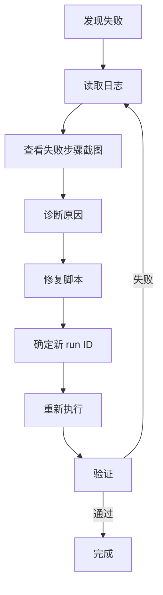

## Webwright 模式：测试脚本修复

**本 skill 在 webwright agent 下运行。诊断脚本失败原因，修复后重新执行（新 run_<id+1>/ 目录）。**

### 修复流程



### 步骤 1：诊断

从以下渠道收集诊断信息：

**1.1 读取 final_script_log.txt**
```
2026-06-27 10:00:01 [INFO] Step 1: 导航到登录页面
2026-06-27 10:00:03 [INFO] Step 1 完成
2026-06-27 10:00:03 [INFO] Step 2: 输入用户名
2026-06-27 10:00:08 [ERROR] 操作超时: locator.fill: Timeout 5000ms exceeded
```

**1.2 查看失败步骤截图**
```
screenshots/
├── final_execution_1_navigate.png    ← 正常
├── final_execution_2_fill_username.png  ← 可能是空白或弹窗遮盖
```

**1.3 分析失败原因**

| 错误类型 | 截图特征 | 常见原因 | 修复方案 |
|----------|---------|---------|---------|
| 元素未找到 | 页面加载不完全 | 网络慢 / 动态加载 | 增加 wait_for_selector |
| 超时 | 页面空白 / 加载中 | 页面改动 / URL 改变 | 检查 URL 和页面结构 |
| 导航失败 | 404 / 错误页 | URL 路径改变 | 更新导航 URL |
| 登录态失效 | 跳转到登录页 | Cookie/Token 过期 | 添加重新登录步骤 |
| 弹窗遮挡 | 页面被弹窗覆盖 | 广告 / 提示弹窗 | 添加关闭弹窗步骤 |

### 步骤 2：修复

修复脚本时需遵循：

1. **不要覆盖原有 run 目录** — 始终在新 run_<id+1>/ 中创建新目录
2. **只修改定位器或逻辑** — 不要改变脚本的测试意图
3. **增加稳定措施** — 添加 wait_for_selector、增加超时
4. **确保截图点完整** — 修复步骤前后都要有截图
5. **更新注释** — 记录修复原因

修复模式示例：
```python
# 原始代码（超时）
await page.fill("input#username", "test_user")

# 修复后：先等待元素可见
await page.wait_for_selector("input#username", timeout=10000)
await page.fill("input#username", "test_user")
await page.screenshot(path=SCREENSHOTS / "final_execution_2_fill_username.png")
```

### 步骤 3：重新执行

```bash
# 创建新 run 目录
mkdir -p final_runs/run_003/screenshots

# 复制修复后的脚本
cp final_script.py final_runs/run_003/final_script.py

# 执行（唯一通道：execute_web_script；⛔ 禁止 shell 直跑 python3，SHELL-POLICY-BANNED）
execute_web_script(local_script_path="final_runs/run_003/final_script.py", framework="python", workspace_mode="webwright", project_identifier=..., sub_function_id=...)
```

### 步骤 4：验证

- [ ] 新 run 目录已创建（run_<id+1>/）
- [ ] 修复后的脚本已保存
- [ ] 脚本返回码为 0
- [ ] 所有截图存在
- [ ] 日志中无 ERROR

### 最大重试次数

每个脚本最多修复 3 次。第 3 次仍失败则记录为「不可修复」，需要人工介入。
